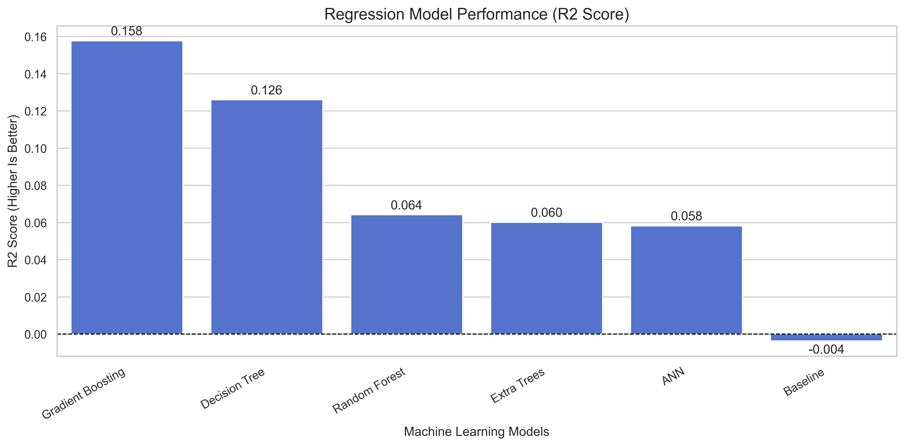
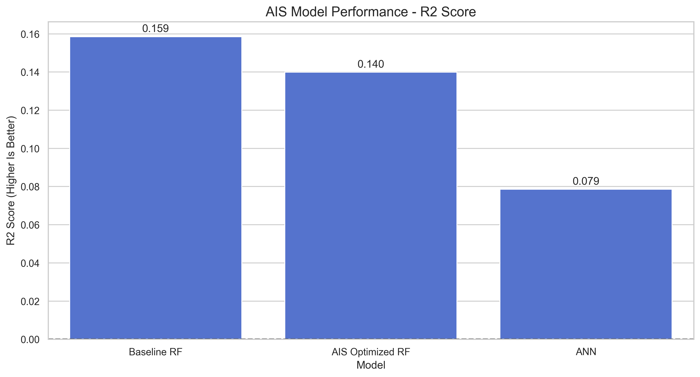
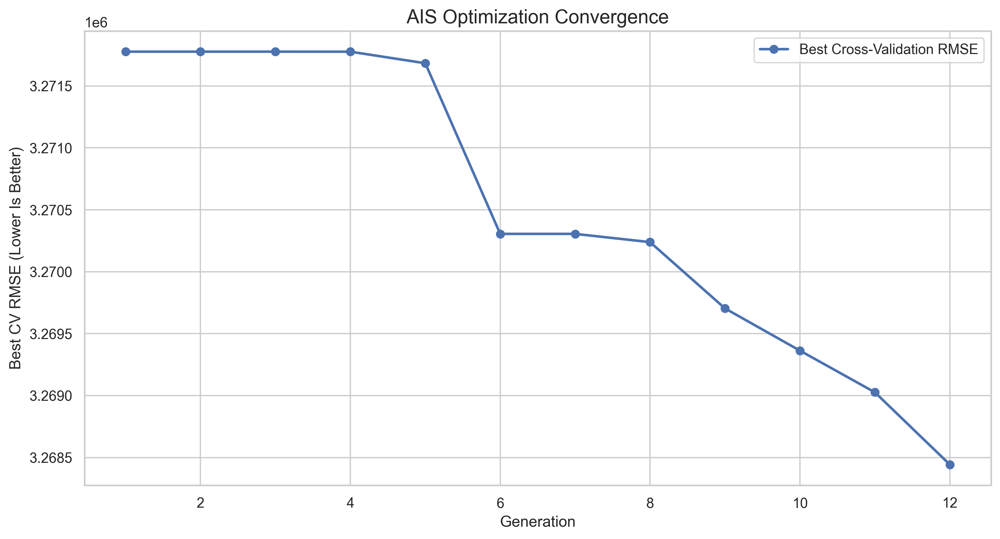
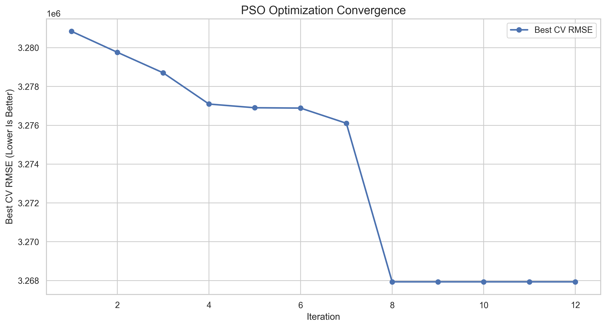
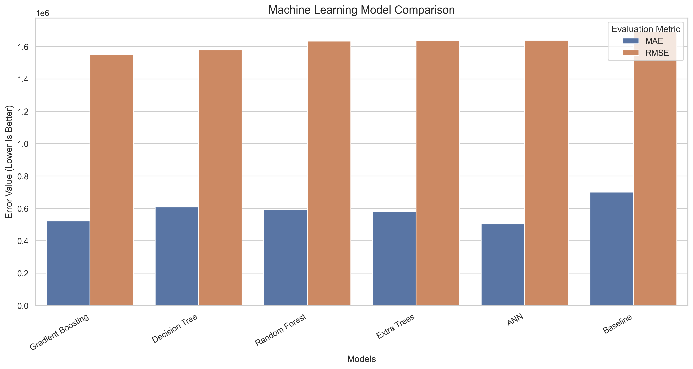
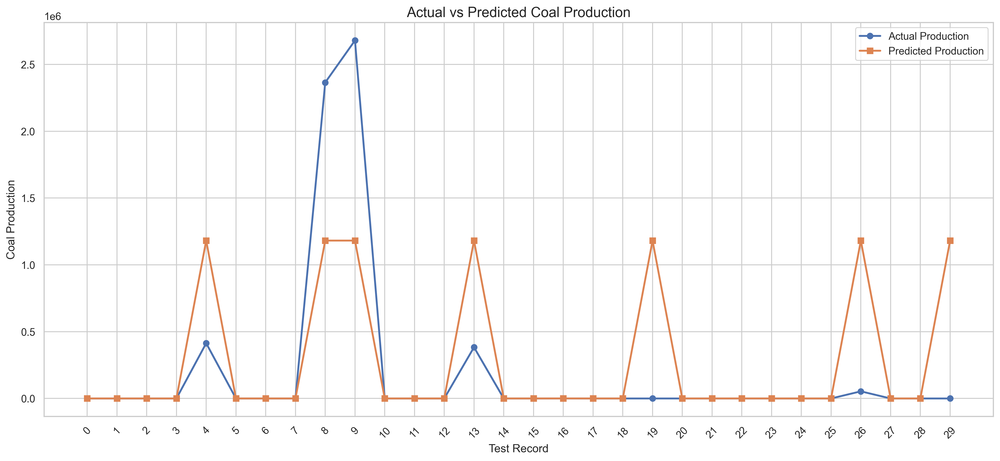
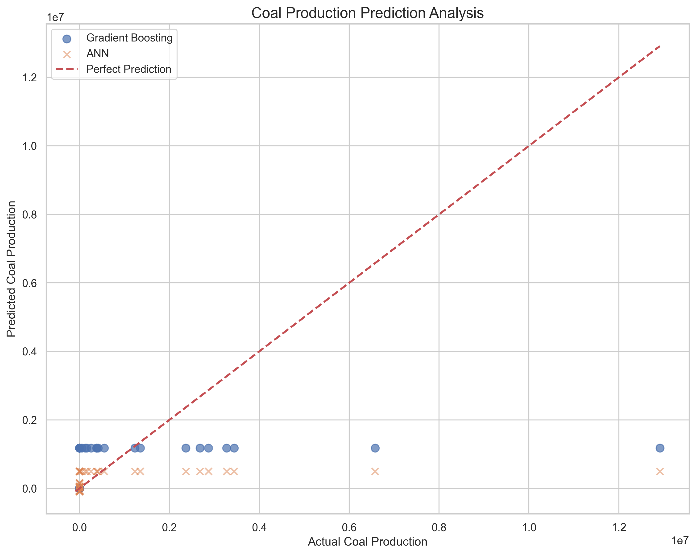
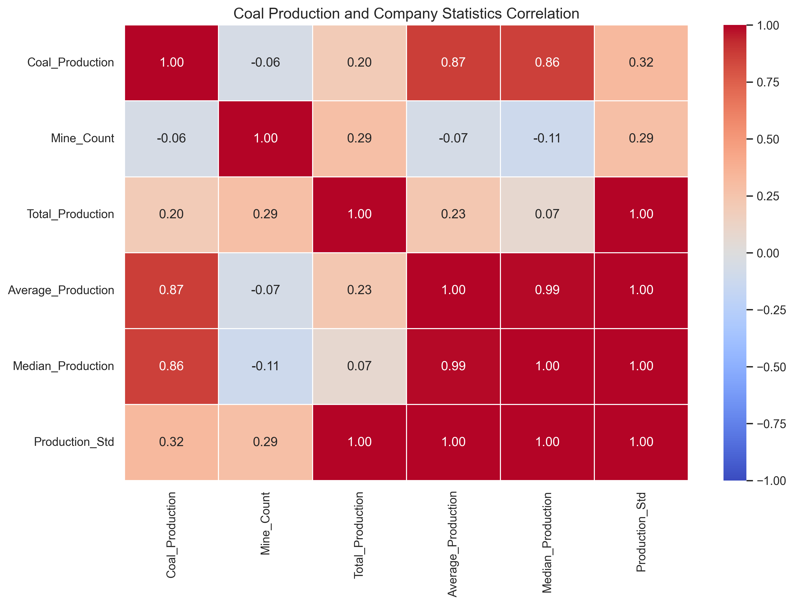
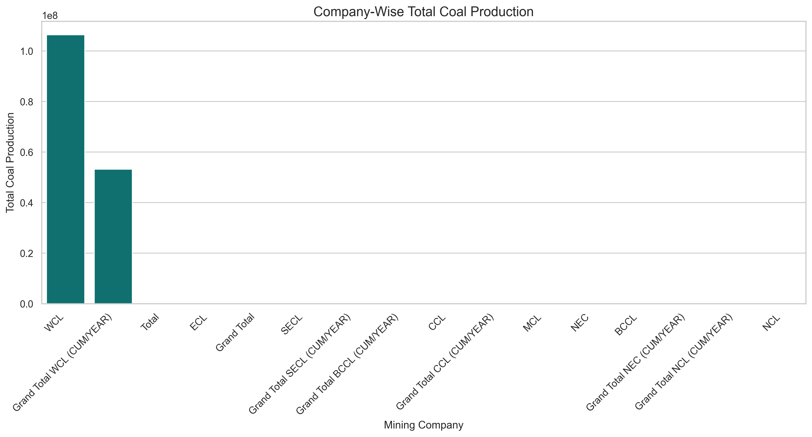

# AI-Based Coal Mine Production Analysis, Mining Company Performance Assessment, and Production Optimization System

## Overview

The **AI-Based Coal Mine Production Analysis, Mining Company Performance Assessment, and Production Optimization System** is a machine learning and data analytics project designed to analyze coal production across different mining companies and individual mines.

The project combines **Machine Learning (ML), Deep Learning (DL), Artificial Immune System (AIS), and Particle Swarm Optimization (PSO)** to investigate coal production patterns, compare mining company performance, estimate production quantities, and optimize predictive model configurations.

The system provides data-driven insights through statistical analysis, machine learning predictions, performance evaluation, and graphical visualizations.

The project uses a coal mining production dataset containing mine names, mining company classifications, and coal production quantities.

---

## Project Objectives

The primary objectives of this project are:

1. Analyze coal production across different mining companies.
2. Evaluate individual mine production performance.
3. Identify high-production and low-production mines.
4. Compare coal production quantities across mining companies.
5. Develop machine learning models for production estimation.
6. Apply deep learning for nonlinear regression.
7. Implement Artificial Immune System optimization.
8. Implement Particle Swarm Optimization.
9. Compare baseline, AIS, and PSO model performance.
10. Generate production analysis reports and visualizations.
11. Support data-driven mining performance assessment.

---

## Main Visualization

The following graph compares the performance of the machine learning models using the R² score.



**Figure 1: Machine Learning Model Performance Using R² Score**

The graph provides a visual comparison of regression model performance.

Higher R² values indicate better predictive performance, while negative values indicate performance worse than predicting the mean production quantity.

The graph is generated automatically during model evaluation.

---

## Dataset Description

### Dataset Name

`rs_session-241_au482_1.1.csv`

### Dataset Source

Coal mine production dataset containing mine-level production records and mining company classifications.

### Dataset Features

| Feature | Description |
|---------|-------------|
| Name of the Mine - Company | Name of the coal mine |
| Type of WCL - NEC - NCL - ECL - BCCL - MCL - CCL - SECL | Mining company classification |
| Quantity for Coal production | Recorded coal production quantity |

### Dataset Processing

The preprocessing pipeline performs:

- Dataset loading using Pandas
- Automatic column identification
- Missing value handling
- Removal of invalid production quantities
- Duplicate record removal
- Categorical feature encoding
- Training and testing data separation
- Feature transformation
- Data preparation for machine learning

### Input Features

The predictive models use:

- Mining company classification

Mine names are retained for reporting and identification.

### Target Variable

`Coal_Production`

The target represents the recorded coal production quantity.

**Dataset limitation:** The dataset contains cross-sectional production records rather than a historical time series. Therefore, the project performs production estimation and analysis, not validated future production forecasting.

---

## Technologies Used

### Programming Language

- Python

### Data Processing

- Pandas
- NumPy

### Machine Learning

- Scikit-learn
- Decision Tree Regressor
- Random Forest Regressor
- Gradient Boosting Regressor
- Extra Trees Regressor
- Dummy Regressor

### Deep Learning

- TensorFlow
- Keras
- Artificial Neural Networks

### Optimization Algorithms

- Artificial Immune System (AIS)
- Clonal Selection Algorithm (CLONALG)
- Particle Swarm Optimization (PSO)

### Visualization

- Matplotlib
- Seaborn

### Model Storage

- Pickle / Joblib
- HDF5
- Keras
- YAML
- JSON

### Development Environment

- Jupyter Notebook
- Python 3
- Visual Studio Code (optional)

---

## System Architecture

The system follows the architecture below:

```text
                  Coal Production Dataset
                            |
                            v
                     Data Loading
                            |
                            v
                     Data Cleaning
                            |
                            v
                  Exploratory Analysis
                            |
                            v
                   Feature Engineering
                            |
                            v
                     Train/Test Split
                            |
              +-------------+-------------+
              |             |             |
              v             v             v
         Baseline ML       AIS           PSO
              |             |             |
              v             v             v
         ML Training   Clonal Search  Swarm Search
              |             |             |
              |             v             v
              |       Optimized RF   Optimized RF
              |             |             |
              +-------------+-------------+
                            |
                            v
                    Model Evaluation
                            |
                            v
                  Performance Comparison
                            |
                            v
                    Prediction Results
                            |
                            v
                  Graphs and CSV Reports
                            |
                            v
                   Saved Model Artifacts
```

A separate ANN is trained for comparison with the regression models.

---

## Machine Learning Implementation

The baseline machine learning system evaluates multiple regression algorithms.

### 1. Decision Tree Regressor

Decision Tree Regression predicts coal production using hierarchical decision rules.

It provides an interpretable model for understanding production differences between mining company categories.

### 2. Random Forest Regressor

Random Forest combines multiple decision trees to generate regression predictions.

It is used as one of the main production estimation models.

### 3. Gradient Boosting Regressor

Gradient Boosting builds an ensemble of models sequentially.

Each successive model attempts to reduce the errors of the preceding models.

### 4. Extra Trees Regressor

Extra Trees uses randomized decision tree ensembles to model relationships between input features and production quantities.

### 5. Artificial Neural Network

The neural network uses dense layers to estimate coal production.

The architecture includes:

- Input layer
- Dense layer with 64 neurons
- Dropout layer
- Dense layer with 32 neurons
- Dense layer with 16 neurons
- Output layer with 1 neuron

The ANN uses:

- ReLU activation
- Adam optimizer
- Mean Squared Error loss
- Early stopping

The trained neural network is saved in `.h5` and `.keras` formats.

---

## Artificial Immune System (AIS)

### Introduction

Artificial Immune System is a bio-inspired optimization technique based on the behavior of biological immune systems.

The project implements the **Clonal Selection Algorithm (CLONALG)** to optimize Random Forest hyperparameters.

### AIS Working Principle

The algorithm follows these steps:

1. Generate an initial population of antibodies.
2. Represent each antibody as a model hyperparameter configuration.
3. Evaluate antibody fitness using cross-validation RMSE.
4. Select high-performing antibodies.
5. Clone selected antibodies.
6. Apply mutation to cloned antibodies.
7. Retain high-performing configurations.
8. Introduce random replacements to maintain diversity.
9. Repeat the optimization process.
10. Train the Random Forest using the selected parameters.

### AIS Hyperparameters

The optimized Random Forest parameters include:

| Parameter | Search Range |
|-----------|--------------|
| n_estimators | 50–250 |
| max_depth | 2–15 |
| min_samples_split | 2–15 |
| min_samples_leaf | 1–10 |
| max_features | 0.3–1.0 |

### AIS Configuration

```yaml
algorithm: Artificial Immune System
variant: Clonal Selection Algorithm
population_size: 12
generations: 12
selected_count: 5
random_replacements: 3
fitness_metric: Cross-validation RMSE
```

### AIS Outputs

- `ais_model.pkl`
- `ais_model.h5`
- `ais_config.yaml`
- `ais_model_metadata.json`
- `ais_accuracy_graph.png`
- `ais_heatmap.png`
- `ais_comparison_graph.png`
- `ais_result.csv`
- `ais_result_graph.png`
- `ais_prediction.csv`
- `ais_prediction_graph.png`
- `ais_convergence_graph.png`
- `ais_optimization_history.csv`

### AIS Visualization



### AIS Convergence



The convergence graph shows the best cross-validation RMSE obtained during successive AIS generations.

---

## Particle Swarm Optimization (PSO)

### Introduction

Particle Swarm Optimization is a population-based optimization algorithm inspired by the collective movement of birds and fish.

In this project, PSO optimizes Random Forest hyperparameters to minimize cross-validation prediction error.

### PSO Working Principle

The algorithm performs the following steps:

1. Initialize a population of particles.
2. Represent each particle as a Random Forest parameter configuration.
3. Evaluate the fitness of each particle.
4. Record each particle's personal best solution.
5. Identify the global best solution.
6. Update particle velocities.
7. Update particle positions.
8. Repeat until the maximum iteration count is reached.
9. Train the optimized Random Forest model.
10. Evaluate the optimized model on held-out test data.

### PSO Velocity Equation

The particle velocity is updated using:

```text
v(t+1) = w*v(t)
       + c1*r1*(pbest - x(t))
       + c2*r2*(gbest - x(t))
```

Where:

- `w` = Inertia weight
- `c1` = Cognitive coefficient
- `c2` = Social coefficient
- `r1`, `r2` = Random values between 0 and 1
- `pbest` = Personal best position
- `gbest` = Global best position
- `x(t)` = Current particle position

### PSO Position Equation

```text
x(t+1) = x(t) + v(t+1)
```

### PSO Configuration

```yaml
algorithm: Particle Swarm Optimization
number_of_particles: 12
maximum_iterations: 12
inertia_weight: 0.7
cognitive_coefficient: 1.5
social_coefficient: 1.5
fitness_metric: Cross-validation RMSE
```

### PSO Outputs

- `pso_model.pkl`
- `pso_model.h5`
- `pso_config.yaml`
- `pso_model_metadata.json`
- `pso_accuracy_graph.png`
- `pso_heatmap.png`
- `pso_comparison_graph.png`
- `pso_result.csv`
- `pso_result_graph.png`
- `pso_prediction.csv`
- `pso_prediction_graph.png`
- `pso_convergence_graph.png`
- `pso_optimization_history.csv`

### PSO Visualization


### PSO Convergence



The convergence graph shows how the best cross-validation RMSE changes during PSO iterations.

---

## Model Evaluation Metrics

The project evaluates regression models using four metrics.

### Mean Absolute Error (MAE)

MAE measures the average absolute difference between actual and predicted production quantities.

```text
MAE = (1/n) * Σ |Actual - Predicted|
```

Lower MAE indicates better performance.

### Mean Squared Error (MSE)

MSE calculates the average squared prediction error.

```text
MSE = (1/n) * Σ (Actual - Predicted)^2
```

Lower MSE indicates better performance.

### Root Mean Squared Error (RMSE)

RMSE measures prediction error in the original units of the target.

```text
RMSE = sqrt(MSE)
```

Lower RMSE indicates better performance.

### R-Squared Score (R²)

R² measures how well the model explains variation in coal production.

```text
R² = 1 - (SS_res / SS_tot)
```

Higher R² generally indicates better predictive performance.

An R² value can be negative.

---

## Model Comparison

The project compares:

| Model | Optimization Method | Evaluation |
|-------|---------------------|------------|
| Decision Tree | Standard training | MAE, RMSE, R² |
| Random Forest | Standard training | MAE, RMSE, R² |
| Gradient Boosting | Standard training | MAE, RMSE, R² |
| Extra Trees | Standard training | MAE, RMSE, R² |
| ANN | Gradient-based training | MAE, RMSE, R² |
| AIS-Optimized RF | Clonal Selection | MAE, RMSE, R² |
| PSO-Optimized RF | Particle Swarm Optimization | MAE, RMSE, R² |

Actual performance values are generated during execution and stored in the model comparison CSV files.

AIS and PSO are not guaranteed to outperform the baseline models.

### Model Comparison Visualization



---

## Results and Predictions

### Result Analysis

The project generates a results CSV containing:

- Mine name
- Mining company
- Actual coal production
- Predicted coal production
- Absolute error
- Squared error
- Percentage error, where defined

### Result Visualization



### Production Estimation

The project generates model estimates for the observed coal mines.

The prediction CSV contains:

- Mine name
- Mining company
- Actual production
- ML predicted production
- ANN predicted production
- Training or testing split

### Prediction Visualization



**Important:** Predictions on training records are in-sample estimates. Held-out test predictions should be used for evaluating generalization.

The system does not predict future yearly production because the dataset does not contain a historical time dimension.

---

## Correlation Analysis

The project generates a correlation heatmap using numerical production values and company-level descriptive statistics.



The heatmap helps visualize statistical relationships between production quantities and company-level characteristics.

These correlations are descriptive and should not be interpreted as causal relationships.

---

## Mining Company Performance Assessment

The system calculates:

- Total coal production by company
- Number of mine records
- Average coal production
- Median coal production
- Production standard deviation

### Company Performance Visualization



This visualization helps identify differences in recorded production across mining companies.

The analysis does not independently measure operational efficiency because capacity, workforce, cost, and resource information are unavailable.

---

## Project Folder Structure

```text
AI-Based Coal Mine Production Analysis/
|
|-- rs_session-241_au482_1.1.csv
|
|-- README.md
|
|-- cleaned_dataset.csv
|-- company_performance.csv
|
|-- coal_production_model.pkl
|-- coal_production_model.h5
|-- coal_production_model.keras
|
|-- config.yaml
|-- model_metadata.json
|
|-- accuracy_graph.png
|-- heatmap.png
|-- comparison_graph.png
|
|-- result.csv
|-- result_graph.png
|
|-- prediction.csv
|-- prediction_graph.png
|
|-- company_production_graph.png
|-- ann_training_graph.png
|
|-- ais_cleaned_dataset.csv
|-- ais_company_performance.csv
|
|-- ais_model.pkl
|-- ais_model.h5
|-- ais_model.keras
|
|-- ais_config.yaml
|-- ais_model_metadata.json
|
|-- ais_accuracy_graph.png
|-- ais_heatmap.png
|-- ais_comparison_graph.png
|
|-- ais_result.csv
|-- ais_result_graph.png
|
|-- ais_prediction.csv
|-- ais_prediction_graph.png
|
|-- ais_convergence_graph.png
|-- ais_optimization_history.csv
|-- ais_ann_training_graph.png
|
|-- pso_cleaned_dataset.csv
|-- pso_company_performance.csv
|
|-- pso_model.pkl
|-- pso_model.h5
|-- pso_model.keras
|
|-- pso_config.yaml
|-- pso_model_metadata.json
|
|-- pso_accuracy_graph.png
|-- pso_heatmap.png
|-- pso_comparison_graph.png
|
|-- pso_result.csv
|-- pso_result_graph.png
|
|-- pso_prediction.csv
|-- pso_prediction_graph.png
|
|-- pso_convergence_graph.png
|-- pso_optimization_history.csv
|-- pso_ann_training_graph.png
```

Additional model and preprocessing files may be generated depending on the implementation.

---

## Installation

### Step 1: Install Python

Install a compatible version of Python with support for TensorFlow and Scikit-learn.

### Step 2: Install Required Libraries

Run:

```bash
pip install numpy pandas scikit-learn tensorflow matplotlib seaborn joblib pyyaml h5py jupyter
```

### Step 3: Open Jupyter Notebook

```bash
jupyter notebook
```

### Step 4: Configure Dataset Path

Set the project directory:

```python
from pathlib import Path

ROOT = Path(
    r"C:\Users\sagni\Downloads\AI-Based Coal Mine Production Analysis, Mining Company Performance Assessment, and Production Optimization System"
)

CSV_PATH = ROOT / "rs_session-241_au482_1.1.csv"
```

### Step 5: Run the Main ML Implementation

Execute the baseline machine learning notebook or code.

This generates:

- Trained ML models
- Neural network model
- Model comparison results
- Accuracy graph
- Heatmap
- Prediction results
- Evaluation graphs

### Step 6: Run the AIS Implementation

Execute the AIS optimization code.

This generates files beginning with:

```text
ais_
```

### Step 7: Run the PSO Implementation

Execute the PSO optimization code.

This generates files beginning with:

```text
pso_
```

### Step 8: Review Results

Open the generated CSV files and PNG graphs to examine model performance and production patterns.

---

## Loading the Trained Models

### Load the Standard ML Model

```python
import joblib
import pandas as pd

model = joblib.load(
    "coal_production_model.pkl"
)

sample = pd.DataFrame({
    "Company": ["WCL"]
})

prediction = model.predict(sample)

print("Predicted Production:", prediction[0])
```

### Load the AIS Model

```python
import joblib
import pandas as pd

ais_model = joblib.load(
    "ais_model.pkl"
)

sample = pd.DataFrame({
    "Company": ["WCL"]
})

prediction = ais_model.predict(sample)

print("AIS Prediction:", prediction[0])
```

### Load the PSO Model

```python
import joblib
import pandas as pd

pso_model = joblib.load(
    "pso_model.pkl"
)

sample = pd.DataFrame({
    "Company": ["WCL"]
})

prediction = pso_model.predict(sample)

print("PSO Prediction:", prediction[0])
```

### Load the Neural Network

```python
from tensorflow.keras.models import load_model
import joblib
import pandas as pd

model = load_model(
    "coal_production_model.h5",
    compile=False
)

preprocessor = joblib.load(
    "nn_preprocessor.pkl"
)

target_scaler = joblib.load(
    "target_scaler.pkl"
)

sample = pd.DataFrame({
    "Company": ["WCL"]
})

features = preprocessor.transform(sample)

scaled_prediction = model.predict(
    features,
    verbose=0
)

prediction = target_scaler.inverse_transform(
    scaled_prediction
)

print("ANN Prediction:", prediction[0][0])
```

Run these examples from the project directory, or replace filenames with full paths.

Use only trusted model files when loading Pickle or Joblib artifacts.

---

## Applications

Potential applications of this project include:

### Coal Production Analysis

Analyze recorded production quantities across different coal mines.

### Mining Company Comparison

Compare production statistics between mining companies.

### Mine Performance Categorization

Group mines into descriptive low, medium, and high production categories.

### Machine Learning Research

Compare traditional regression algorithms with neural networks.

### Bio-Inspired Optimization Research

Investigate the effectiveness of AIS and PSO for hyperparameter optimization.

### Academic Research

Study the use of artificial intelligence and optimization algorithms in mining-related datasets.

---

## Advantages

- Automated dataset preprocessing
- Multiple machine learning algorithms
- Deep learning integration
- AIS hyperparameter optimization
- PSO hyperparameter optimization
- Model comparison using standard regression metrics
- Automated visualization generation
- CSV-based reporting
- Model persistence using PKL and H5
- Reproducible random seed configuration
- Modular and extensible implementation

---

## Limitations

The current system has several limitations:

1. The dataset contains limited predictive features.
2. Mine names are identifiers rather than operational measurements.
3. Historical production records are unavailable.
4. Future production forecasting cannot be validated.
5. Production capacity and operating costs are not included.
6. AIS and PSO optimize model hyperparameters rather than real mining operations.
7. Model performance may be limited by differences between mines within the same company.
8. Correlation does not establish causation.

These limitations should be considered when interpreting model predictions and optimization results.

---

## Future Enhancements

The project can be extended through:

### 1. Historical Production Forecasting

Add monthly or yearly coal production records to develop time-series forecasting models.

### 2. Mining Capacity Analysis

Include production capacity, machinery utilization, and operational constraints.

### 3. Resource Optimization

Use AIS and PSO to optimize production allocation under realistic capacity and cost constraints.

### 4. Environmental Impact Analysis

Integrate carbon emissions, energy consumption, and environmental compliance indicators.

### 5. Geographic Visualization

Add mine coordinates and geographic information system (GIS) mapping.

### 6. Interactive Dashboard

Develop a Streamlit or Flask dashboard for interactive production analysis.

### 7. Advanced Machine Learning

Explore XGBoost, LightGBM, and other regression algorithms.

### 8. Hybrid Optimization

Investigate combined AIS-PSO optimization approaches.

### 9. Explainable AI

Use feature importance and SHAP-based explanations to understand model behavior.

### 10. Automated Reporting

Generate PDF reports containing production statistics, model evaluations, and optimization results.

---

## Research Contribution

The project demonstrates the application of machine learning and bio-inspired optimization to coal mine production data.

Its main contributions include:

- Comparative analysis of coal production records
- Development of baseline regression models
- Neural network-based production estimation
- AIS-based Random Forest hyperparameter optimization
- PSO-based Random Forest hyperparameter optimization
- Evaluation through MAE, MSE, RMSE, and R²
- Automated generation of model artifacts and visualizations

The project provides an experimental framework for studying AI-based production analysis.

---

## Conclusion

The **AI-Based Coal Mine Production Analysis, Mining Company Performance Assessment, and Production Optimization System** integrates data analytics, machine learning, deep learning, and bio-inspired optimization techniques into a unified experimental workflow.

The system analyzes coal production records, compares mining companies, develops production estimation models, and evaluates the effectiveness of Artificial Immune System and Particle Swarm Optimization for Random Forest hyperparameter tuning.

The project demonstrates how AI techniques can support exploratory analysis and predictive modeling of mining production data.

With additional historical, operational, and resource information, the system could be extended toward more reliable production forecasting and real-world mining resource optimization.

---

## Keywords

Artificial Intelligence, Machine Learning, Deep Learning, Coal Mining, Coal Production Analysis, Mining Company Performance, Random Forest, Decision Tree, Gradient Boosting, Artificial Neural Network, Artificial Immune System, AIS, Clonal Selection Algorithm, CLONALG, Particle Swarm Optimization, PSO, Hyperparameter Optimization, Regression Analysis, Predictive Analytics, Data Visualization, Python, Scikit-learn, TensorFlow, Keras.

---

## License

This project is intended for educational and research purposes.

Dataset usage and redistribution remain subject to the terms of the original data provider.

---

## Disclaimer

The results are intended for academic analysis and experimentation.

The system should not be used as the sole basis for operational mining decisions without additional validated data, domain-specific constraints, and independent evaluation.

# AI-Based Coal Mine Production Analysis, Mining Company Performance Assessment, and Production Optimization System

## Overview

The **AI-Based Coal Mine Production Analysis, Mining Company Performance Assessment, and Production Optimization System** is a machine learning and data analytics project designed to analyze coal production across different mining companies and individual mines.

The project combines **Machine Learning (ML), Deep Learning (DL), Artificial Immune System (AIS), and Particle Swarm Optimization (PSO)** to investigate coal production patterns, compare mining company performance, estimate production quantities, and optimize predictive model configurations.

The system provides data-driven insights through statistical analysis, machine learning predictions, performance evaluation, and graphical visualizations.

The project uses a coal mining production dataset containing mine names, mining company classifications, and coal production quantities.

---

## Project Objectives

The primary objectives of this project are:

1. Analyze coal production across different mining companies.
2. Evaluate individual mine production performance.
3. Identify high-production and low-production mines.
4. Compare coal production quantities across mining companies.
5. Develop machine learning models for production estimation.
6. Apply deep learning for nonlinear regression.
7. Implement Artificial Immune System optimization.
8. Implement Particle Swarm Optimization.
9. Compare baseline, AIS, and PSO model performance.
10. Generate production analysis reports and visualizations.
11. Support data-driven mining performance assessment.

---

## Main Visualization

The following graph compares the performance of the machine learning models using the R² score.


**Figure 1: Machine Learning Model Performance Using R² Score**

The graph provides a visual comparison of regression model performance.

Higher R² values indicate better predictive performance, while negative values indicate performance worse than predicting the mean production quantity.

The graph is generated automatically during model evaluation.

---

## Dataset Description

### Dataset Name

`rs_session-241_au482_1.1.csv`

### Dataset Source

Coal mine production dataset containing mine-level production records and mining company classifications.

### Dataset Features

| Feature | Description |
|---------|-------------|
| Name of the Mine - Company | Name of the coal mine |
| Type of WCL - NEC - NCL - ECL - BCCL - MCL - CCL - SECL | Mining company classification |
| Quantity for Coal production | Recorded coal production quantity |

### Dataset Processing

The preprocessing pipeline performs:

- Dataset loading using Pandas
- Automatic column identification
- Missing value handling
- Removal of invalid production quantities
- Duplicate record removal
- Categorical feature encoding
- Training and testing data separation
- Feature transformation
- Data preparation for machine learning

### Input Features

The predictive models use:

- Mining company classification

Mine names are retained for reporting and identification.

### Target Variable

`Coal_Production`

The target represents the recorded coal production quantity.

**Dataset limitation:** The dataset contains cross-sectional production records rather than a historical time series. Therefore, the project performs production estimation and analysis, not validated future production forecasting.

---

## Technologies Used

### Programming Language

- Python

### Data Processing

- Pandas
- NumPy

### Machine Learning

- Scikit-learn
- Decision Tree Regressor
- Random Forest Regressor
- Gradient Boosting Regressor
- Extra Trees Regressor
- Dummy Regressor

### Deep Learning

- TensorFlow
- Keras
- Artificial Neural Networks

### Optimization Algorithms

- Artificial Immune System (AIS)
- Clonal Selection Algorithm (CLONALG)
- Particle Swarm Optimization (PSO)

### Visualization

- Matplotlib
- Seaborn

### Model Storage

- Pickle / Joblib
- HDF5
- Keras
- YAML
- JSON

### Development Environment

- Jupyter Notebook
- Python 3
- Visual Studio Code (optional)

---

## System Architecture

The system follows the architecture below:

```text
                  Coal Production Dataset
                            |
                            v
                     Data Loading
                            |
                            v
                     Data Cleaning
                            |
                            v
                  Exploratory Analysis
                            |
                            v
                   Feature Engineering
                            |
                            v
                     Train/Test Split
                            |
              +-------------+-------------+
              |             |             |
              v             v             v
         Baseline ML       AIS           PSO
              |             |             |
              v             v             v
         ML Training   Clonal Search  Swarm Search
              |             |             |
              |             v             v
              |       Optimized RF   Optimized RF
              |             |             |
              +-------------+-------------+
                            |
                            v
                    Model Evaluation
                            |
                            v
                  Performance Comparison
                            |
                            v
                    Prediction Results
                            |
                            v
                  Graphs and CSV Reports
                            |
                            v
                   Saved Model Artifacts
```

A separate ANN is trained for comparison with the regression models.

---

## Machine Learning Implementation

The baseline machine learning system evaluates multiple regression algorithms.

### 1. Decision Tree Regressor

Decision Tree Regression predicts coal production using hierarchical decision rules.

It provides an interpretable model for understanding production differences between mining company categories.

### 2. Random Forest Regressor

Random Forest combines multiple decision trees to generate regression predictions.

It is used as one of the main production estimation models.

### 3. Gradient Boosting Regressor

Gradient Boosting builds an ensemble of models sequentially.

Each successive model attempts to reduce the errors of the preceding models.

### 4. Extra Trees Regressor

Extra Trees uses randomized decision tree ensembles to model relationships between input features and production quantities.

### 5. Artificial Neural Network

The neural network uses dense layers to estimate coal production.

The architecture includes:

- Input layer
- Dense layer with 64 neurons
- Dropout layer
- Dense layer with 32 neurons
- Dense layer with 16 neurons
- Output layer with 1 neuron

The ANN uses:

- ReLU activation
- Adam optimizer
- Mean Squared Error loss
- Early stopping

The trained neural network is saved in `.h5` and `.keras` formats.

---

## Artificial Immune System (AIS)

### Introduction

Artificial Immune System is a bio-inspired optimization technique based on the behavior of biological immune systems.

The project implements the **Clonal Selection Algorithm (CLONALG)** to optimize Random Forest hyperparameters.

### AIS Working Principle

The algorithm follows these steps:

1. Generate an initial population of antibodies.
2. Represent each antibody as a model hyperparameter configuration.
3. Evaluate antibody fitness using cross-validation RMSE.
4. Select high-performing antibodies.
5. Clone selected antibodies.
6. Apply mutation to cloned antibodies.
7. Retain high-performing configurations.
8. Introduce random replacements to maintain diversity.
9. Repeat the optimization process.
10. Train the Random Forest using the selected parameters.

### AIS Hyperparameters

The optimized Random Forest parameters include:

| Parameter | Search Range |
|-----------|--------------|
| n_estimators | 50–250 |
| max_depth | 2–15 |
| min_samples_split | 2–15 |
| min_samples_leaf | 1–10 |
| max_features | 0.3–1.0 |

### AIS Configuration

```yaml
algorithm: Artificial Immune System
variant: Clonal Selection Algorithm
population_size: 12
generations: 12
selected_count: 5
random_replacements: 3
fitness_metric: Cross-validation RMSE
```

### AIS Outputs

- `ais_model.pkl`
- `ais_model.h5`
- `ais_config.yaml`
- `ais_model_metadata.json`
- `ais_accuracy_graph.png`
- `ais_heatmap.png`
- `ais_comparison_graph.png`
- `ais_result.csv`
- `ais_result_graph.png`
- `ais_prediction.csv`
- `ais_prediction_graph.png`
- `ais_convergence_graph.png`
- `ais_optimization_history.csv`

### AIS Visualization


### AIS Convergence


The convergence graph shows the best cross-validation RMSE obtained during successive AIS generations.

---

## Particle Swarm Optimization (PSO)

### Introduction

Particle Swarm Optimization is a population-based optimization algorithm inspired by the collective movement of birds and fish.

In this project, PSO optimizes Random Forest hyperparameters to minimize cross-validation prediction error.

### PSO Working Principle

The algorithm performs the following steps:

1. Initialize a population of particles.
2. Represent each particle as a Random Forest parameter configuration.
3. Evaluate the fitness of each particle.
4. Record each particle's personal best solution.
5. Identify the global best solution.
6. Update particle velocities.
7. Update particle positions.
8. Repeat until the maximum iteration count is reached.
9. Train the optimized Random Forest model.
10. Evaluate the optimized model on held-out test data.

### PSO Velocity Equation

The particle velocity is updated using:

```text
v(t+1) = w*v(t)
       + c1*r1*(pbest - x(t))
       + c2*r2*(gbest - x(t))
```

Where:

- `w` = Inertia weight
- `c1` = Cognitive coefficient
- `c2` = Social coefficient
- `r1`, `r2` = Random values between 0 and 1
- `pbest` = Personal best position
- `gbest` = Global best position
- `x(t)` = Current particle position

### PSO Position Equation

```text
x(t+1) = x(t) + v(t+1)
```

### PSO Configuration

```yaml
algorithm: Particle Swarm Optimization
number_of_particles: 12
maximum_iterations: 12
inertia_weight: 0.7
cognitive_coefficient: 1.5
social_coefficient: 1.5
fitness_metric: Cross-validation RMSE
```

### PSO Outputs

- `pso_model.pkl`
- `pso_model.h5`
- `pso_config.yaml`
- `pso_model_metadata.json`
- `pso_accuracy_graph.png`
- `pso_heatmap.png`
- `pso_comparison_graph.png`
- `pso_result.csv`
- `pso_result_graph.png`
- `pso_prediction.csv`
- `pso_prediction_graph.png`
- `pso_convergence_graph.png`
- `pso_optimization_history.csv`

### PSO Visualization


### PSO Convergence


The convergence graph shows how the best cross-validation RMSE changes during PSO iterations.

---

## Model Evaluation Metrics

The project evaluates regression models using four metrics.

### Mean Absolute Error (MAE)

MAE measures the average absolute difference between actual and predicted production quantities.

```text
MAE = (1/n) * Σ |Actual - Predicted|
```

Lower MAE indicates better performance.

### Mean Squared Error (MSE)

MSE calculates the average squared prediction error.

```text
MSE = (1/n) * Σ (Actual - Predicted)^2
```

Lower MSE indicates better performance.

### Root Mean Squared Error (RMSE)

RMSE measures prediction error in the original units of the target.

```text
RMSE = sqrt(MSE)
```

Lower RMSE indicates better performance.

### R-Squared Score (R²)

R² measures how well the model explains variation in coal production.

```text
R² = 1 - (SS_res / SS_tot)
```

Higher R² generally indicates better predictive performance.

An R² value can be negative.

---

## Model Comparison

The project compares:

| Model | Optimization Method | Evaluation |
|-------|---------------------|------------|
| Decision Tree | Standard training | MAE, RMSE, R² |
| Random Forest | Standard training | MAE, RMSE, R² |
| Gradient Boosting | Standard training | MAE, RMSE, R² |
| Extra Trees | Standard training | MAE, RMSE, R² |
| ANN | Gradient-based training | MAE, RMSE, R² |
| AIS-Optimized RF | Clonal Selection | MAE, RMSE, R² |
| PSO-Optimized RF | Particle Swarm Optimization | MAE, RMSE, R² |

Actual performance values are generated during execution and stored in the model comparison CSV files.

AIS and PSO are not guaranteed to outperform the baseline models.

### Model Comparison Visualization


---

## Results and Predictions

### Result Analysis

The project generates a results CSV containing:

- Mine name
- Mining company
- Actual coal production
- Predicted coal production
- Absolute error
- Squared error
- Percentage error, where defined

### Result Visualization


### Production Estimation

The project generates model estimates for the observed coal mines.

The prediction CSV contains:

- Mine name
- Mining company
- Actual production
- ML predicted production
- ANN predicted production
- Training or testing split

### Prediction Visualization


**Important:** Predictions on training records are in-sample estimates. Held-out test predictions should be used for evaluating generalization.

The system does not predict future yearly production because the dataset does not contain a historical time dimension.

---

## Correlation Analysis

The project generates a correlation heatmap using numerical production values and company-level descriptive statistics.


The heatmap helps visualize statistical relationships between production quantities and company-level characteristics.

These correlations are descriptive and should not be interpreted as causal relationships.

---

## Mining Company Performance Assessment

The system calculates:

- Total coal production by company
- Number of mine records
- Average coal production
- Median coal production
- Production standard deviation

### Company Performance Visualization


This visualization helps identify differences in recorded production across mining companies.

The analysis does not independently measure operational efficiency because capacity, workforce, cost, and resource information are unavailable.

---

## Project Folder Structure

```text
AI-Based Coal Mine Production Analysis/
|
|-- rs_session-241_au482_1.1.csv
|
|-- README.md
|
|-- cleaned_dataset.csv
|-- company_performance.csv
|
|-- coal_production_model.pkl
|-- coal_production_model.h5
|-- coal_production_model.keras
|
|-- config.yaml
|-- model_metadata.json
|
|-- accuracy_graph.png
|-- heatmap.png
|-- comparison_graph.png
|
|-- result.csv
|-- result_graph.png
|
|-- prediction.csv
|-- prediction_graph.png
|
|-- company_production_graph.png
|-- ann_training_graph.png
|
|-- ais_cleaned_dataset.csv
|-- ais_company_performance.csv
|
|-- ais_model.pkl
|-- ais_model.h5
|-- ais_model.keras
|
|-- ais_config.yaml
|-- ais_model_metadata.json
|
|-- ais_accuracy_graph.png
|-- ais_heatmap.png
|-- ais_comparison_graph.png
|
|-- ais_result.csv
|-- ais_result_graph.png
|
|-- ais_prediction.csv
|-- ais_prediction_graph.png
|
|-- ais_convergence_graph.png
|-- ais_optimization_history.csv
|-- ais_ann_training_graph.png
|
|-- pso_cleaned_dataset.csv
|-- pso_company_performance.csv
|
|-- pso_model.pkl
|-- pso_model.h5
|-- pso_model.keras
|
|-- pso_config.yaml
|-- pso_model_metadata.json
|
|-- pso_accuracy_graph.png
|-- pso_heatmap.png
|-- pso_comparison_graph.png
|
|-- pso_result.csv
|-- pso_result_graph.png
|
|-- pso_prediction.csv
|-- pso_prediction_graph.png
|
|-- pso_convergence_graph.png
|-- pso_optimization_history.csv
|-- pso_ann_training_graph.png
```

Additional model and preprocessing files may be generated depending on the implementation.

---

## Installation

### Step 1: Install Python

Install a compatible version of Python with support for TensorFlow and Scikit-learn.

### Step 2: Install Required Libraries

Run:

```bash
pip install numpy pandas scikit-learn tensorflow matplotlib seaborn joblib pyyaml h5py jupyter
```

### Step 3: Open Jupyter Notebook

```bash
jupyter notebook
```

### Step 4: Configure Dataset Path

Set the project directory:

```python
from pathlib import Path

ROOT = Path(
    r"C:\Users\sagni\Downloads\AI-Based Coal Mine Production Analysis, Mining Company Performance Assessment, and Production Optimization System"
)

CSV_PATH = ROOT / "rs_session-241_au482_1.1.csv"
```

### Step 5: Run the Main ML Implementation

Execute the baseline machine learning notebook or code.

This generates:

- Trained ML models
- Neural network model
- Model comparison results
- Accuracy graph
- Heatmap
- Prediction results
- Evaluation graphs

### Step 6: Run the AIS Implementation

Execute the AIS optimization code.

This generates files beginning with:

```text
ais_
```

### Step 7: Run the PSO Implementation

Execute the PSO optimization code.

This generates files beginning with:

```text
pso_
```

### Step 8: Review Results

Open the generated CSV files and PNG graphs to examine model performance and production patterns.

---

## Loading the Trained Models

### Load the Standard ML Model

```python
import joblib
import pandas as pd

model = joblib.load(
    "coal_production_model.pkl"
)

sample = pd.DataFrame({
    "Company": ["WCL"]
})

prediction = model.predict(sample)

print("Predicted Production:", prediction[0])
```

### Load the AIS Model

```python
import joblib
import pandas as pd

ais_model = joblib.load(
    "ais_model.pkl"
)

sample = pd.DataFrame({
    "Company": ["WCL"]
})

prediction = ais_model.predict(sample)

print("AIS Prediction:", prediction[0])
```

### Load the PSO Model

```python
import joblib
import pandas as pd

pso_model = joblib.load(
    "pso_model.pkl"
)

sample = pd.DataFrame({
    "Company": ["WCL"]
})

prediction = pso_model.predict(sample)

print("PSO Prediction:", prediction[0])
```

### Load the Neural Network

```python
from tensorflow.keras.models import load_model
import joblib
import pandas as pd

model = load_model(
    "coal_production_model.h5",
    compile=False
)

preprocessor = joblib.load(
    "nn_preprocessor.pkl"
)

target_scaler = joblib.load(
    "target_scaler.pkl"
)

sample = pd.DataFrame({
    "Company": ["WCL"]
})

features = preprocessor.transform(sample)

scaled_prediction = model.predict(
    features,
    verbose=0
)

prediction = target_scaler.inverse_transform(
    scaled_prediction
)

print("ANN Prediction:", prediction[0][0])
```

Run these examples from the project directory, or replace filenames with full paths.

Use only trusted model files when loading Pickle or Joblib artifacts.

---

## Applications

Potential applications of this project include:

### Coal Production Analysis

Analyze recorded production quantities across different coal mines.

### Mining Company Comparison

Compare production statistics between mining companies.

### Mine Performance Categorization

Group mines into descriptive low, medium, and high production categories.

### Machine Learning Research

Compare traditional regression algorithms with neural networks.

### Bio-Inspired Optimization Research

Investigate the effectiveness of AIS and PSO for hyperparameter optimization.

### Academic Research

Study the use of artificial intelligence and optimization algorithms in mining-related datasets.

---

## Advantages

- Automated dataset preprocessing
- Multiple machine learning algorithms
- Deep learning integration
- AIS hyperparameter optimization
- PSO hyperparameter optimization
- Model comparison using standard regression metrics
- Automated visualization generation
- CSV-based reporting
- Model persistence using PKL and H5
- Reproducible random seed configuration
- Modular and extensible implementation

---

## Limitations

The current system has several limitations:

1. The dataset contains limited predictive features.
2. Mine names are identifiers rather than operational measurements.
3. Historical production records are unavailable.
4. Future production forecasting cannot be validated.
5. Production capacity and operating costs are not included.
6. AIS and PSO optimize model hyperparameters rather than real mining operations.
7. Model performance may be limited by differences between mines within the same company.
8. Correlation does not establish causation.

These limitations should be considered when interpreting model predictions and optimization results.

---

## Future Enhancements

The project can be extended through:

### 1. Historical Production Forecasting

Add monthly or yearly coal production records to develop time-series forecasting models.

### 2. Mining Capacity Analysis

Include production capacity, machinery utilization, and operational constraints.

### 3. Resource Optimization

Use AIS and PSO to optimize production allocation under realistic capacity and cost constraints.

### 4. Environmental Impact Analysis

Integrate carbon emissions, energy consumption, and environmental compliance indicators.

### 5. Geographic Visualization

Add mine coordinates and geographic information system (GIS) mapping.

### 6. Interactive Dashboard

Develop a Streamlit or Flask dashboard for interactive production analysis.

### 7. Advanced Machine Learning

Explore XGBoost, LightGBM, and other regression algorithms.

### 8. Hybrid Optimization

Investigate combined AIS-PSO optimization approaches.

### 9. Explainable AI

Use feature importance and SHAP-based explanations to understand model behavior.

### 10. Automated Reporting

Generate PDF reports containing production statistics, model evaluations, and optimization results.

---

## Research Contribution

The project demonstrates the application of machine learning and bio-inspired optimization to coal mine production data.

Its main contributions include:

- Comparative analysis of coal production records
- Development of baseline regression models
- Neural network-based production estimation
- AIS-based Random Forest hyperparameter optimization
- PSO-based Random Forest hyperparameter optimization
- Evaluation through MAE, MSE, RMSE, and R²
- Automated generation of model artifacts and visualizations

The project provides an experimental framework for studying AI-based production analysis.

---

## Conclusion

The **AI-Based Coal Mine Production Analysis, Mining Company Performance Assessment, and Production Optimization System** integrates data analytics, machine learning, deep learning, and bio-inspired optimization techniques into a unified experimental workflow.

The system analyzes coal production records, compares mining companies, develops production estimation models, and evaluates the effectiveness of Artificial Immune System and Particle Swarm Optimization for Random Forest hyperparameter tuning.

The project demonstrates how AI techniques can support exploratory analysis and predictive modeling of mining production data.

With additional historical, operational, and resource information, the system could be extended toward more reliable production forecasting and real-world mining resource optimization.

---

## Keywords

Artificial Intelligence, Machine Learning, Deep Learning, Coal Mining, Coal Production Analysis, Mining Company Performance, Random Forest, Decision Tree, Gradient Boosting, Artificial Neural Network, Artificial Immune System, AIS, Clonal Selection Algorithm, CLONALG, Particle Swarm Optimization, PSO, Hyperparameter Optimization, Regression Analysis, Predictive Analytics, Data Visualization, Python, Scikit-learn, TensorFlow, Keras.

---

## License

This project is intended for educational and research purposes.

Dataset usage and redistribution remain subject to the terms of the original data provider.

---

## Disclaimer

The results are intended for academic analysis and experimentation.

The system should not be used as the sole basis for operational mining decisions without additional validated data, domain-specific constraints, and independent evaluation.
